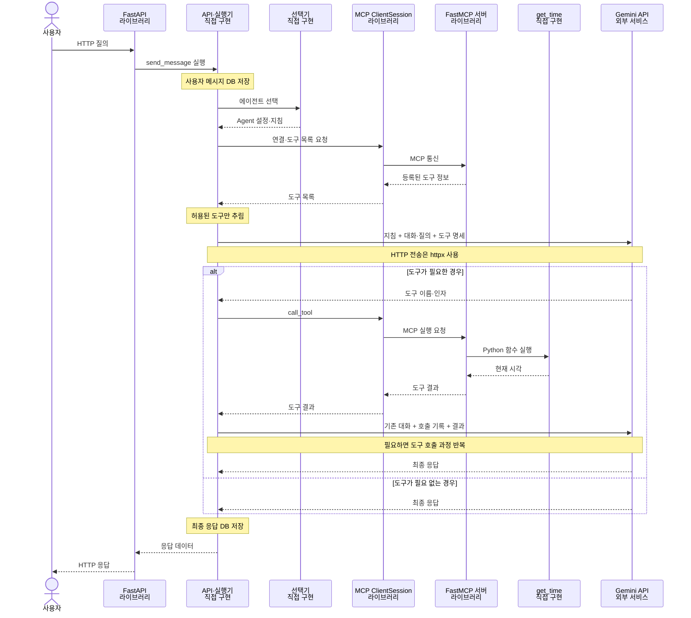

에이전트 개발을 이해하기 위해 한국어 인사와 현재 시각을 안내하는 작은 프로젝트를 살펴봤다. 처음에는 에이전트를 정의하는 파일, LLM, MCP 서버가 각각 무엇을 담당하는지 잘 구분되지 않았다.

“폴더 하나가 에이전트 하나인가?”, “도구 목록은 어디서 가져오는가?”, “LLM이 직접 Python 함수를 실행하는가?”를 질문하면서 코드를 따라갔다. 이 글은 그 과정에서 이해한 내용을 현재 프로젝트의 구현에 맞춰 정리한 학습 기록이다.

이 프로젝트는 Python, FastAPI, Gemini API, MCP Python SDK, SQLite를 사용한다. 설정 경로와 에이전트 선택 규칙은 학습용으로 정한 것이며, 모든 에이전트 프레임워크의 공통 규격을 설명하는 것은 아니다.

## 1. 먼저 전체 흐름부터 보기

현재 프로젝트에서 메시지 하나가 처리되는 흐름은 다음과 같다.

```text
사용자 질의
  ↓
사용자 메시지 DB 저장
  ↓
에이전트 선택
  ↓
선택한 에이전트의 도구 설정 확인
  ↓
MCP 서버 연결 및 허용된 도구 정보 조회
  ↓
LLM에 행동 지침 + 대화 이력 + 현재 질의 + 도구 정보 전달
  ↓
LLM이 호출할 도구와 인자 반환
  ↓
우리 실행기가 MCP 서버에 도구 호출
  ↓
도구 호출 기록과 실행 결과를 LLM에 다시 전달
  ↓
LLM이 최종 응답 생성
  ↓
응답 DB 저장 및 사용자에게 반환
```

도구가 필요 없는 질문이라면 첫 LLM 호출에서 바로 최종 응답이 나온다. 도구를 더 사용해야 한다면 도구 요청, 실행, 결과 전달을 반복한다.

여기서 가장 중요하게 이해한 점은 **LLM이 도구 호출을 요청하고, 실제 실행은 우리가 작성한 실행기가 담당한다**는 것이다.

## 2. harness는 무엇이고, 이 폴더 구조는 표준일까?

`harness`는 에이전트의 실행을 받쳐주는 주변 환경을 가리키는 용어다. 모델에 지침을 전달하고, 도구를 연결하고, 실행 과정을 제어하는 코드와 설정을 생각하면 된다.

현재 프로젝트의 구성은 다음과 같다.

```text
resources/
  harness/
    subagents/
      hello-korean/
        agent.toml
        AGENTS.md
        tools/
          mytool.toml
```

여기서 `resources/harness/`에는 실행 환경에 사용할 설정 파일을 모아 두었다. 실제 로딩과 실행은 별도의 Python 코드가 담당한다.

처음에는 이 경로가 에이전트 개발의 정해진 규격인 줄 알았다. 하지만 **`resources/harness/subagents/`라는 경로와 파일 구성은 이 프로젝트의 규칙**이다. Python이 특별하게 해석하는 폴더명이 아니다.

다른 프로젝트에서는 설정을 다른 폴더에 두거나, 코드에서 직접 에이전트 객체를 생성할 수도 있다. 이 프로젝트에서도 경로를 바꾸려면 설정을 읽는 로더의 경로를 함께 바꾸면 된다.

## 3. 디렉터리 하나가 에이전트 하나인가?

현재 구조에서는 `subagents/` 바로 아래의 디렉터리 하나가 에이전트 하나를 정의하는 단위다.

```text
subagents/
  hello-korean/       → 에이전트 정의 하나
  another-agent/      → 다른 에이전트 정의
```

하지만 각 폴더마다 독립적인 서버나 프로세스가 뜨는 것은 아니다.

- 서버 시작 시 각 폴더의 파일을 읽어 메모리에 `Agent` 객체를 만든다.
- 요청이 들어오면 그 객체 중 하나를 선택한다.
- 선택된 객체의 설정과 지침으로 실행을 진행한다.

즉, **등록과 실행은 서로 다른 단계**다. 실제 식별 이름은 디렉터리명이 아니라 `agent.toml`의 `name` 값이다.

파일을 찾는 코드는 `registry.py`에 있다.

```python
for config in sorted(root.glob("*/agent.toml")):
    ...
```

`root`는 `resources/harness/subagents`다. 그 바로 아래 폴더의 `agent.toml`을 찾으며, 모든 하위 파일을 재귀적으로 에이전트로 만드는 방식은 아니다. 이름이 비어 있는 설정은 건너뛰고, 등록할 에이전트의 `AGENTS.md` 등도 읽는다.

또한 이 프로젝트에서 `subagents`라는 이름을 썼다고 해서 상위 LLM이 다른 LLM 에이전트에게 작업을 위임하는 기능까지 자동으로 생기는 것은 아니다. 현재는 Python 라우터가 에이전트를 고르고 공통 실행기가 실행한다.

## 4. agent.toml과 AGENTS.md에는 무엇을 적을까?

각 파일은 역할이 다르다.

| 파일 | 담고 있는 정보 |
| --- | --- |
| `agent.toml` | 에이전트의 이름, 설명, 태그, 모델 설정 |
| `AGENTS.md` | LLM에게 전달할 행동 지침 |
| `tools/mytool.toml` | MCP 서버 주소와 사용할 도구의 허용 목록 |

### TOML은 설정 데이터를 담는 형식

TOML은 설정을 `키 = 값` 형태로 작성하는 텍스트 형식이다. 문법은 [TOML 규격](https://toml.io/en/v1.0.0)에 정의되어 있다.

현재 에이전트 설정은 다음과 같다.

```toml
name = "hello-korean"
description = "현재 시각을 도구로 확인하고 한국어 인사와 한 줄 격언을 제공합니다."
tags = ["안녕", "인사", "몇 시", "몇시", "현재 시각", "시간"]
model = "gemini/gemini-3.5-flash-lite"
```

여기서 구분할 것이 있다.

**TOML 문법은 표준이지만, `agent.toml`의 키와 의미는 우리 코드에서 정한 규칙**이다.

예를 들어 `tags`를 이용해 에이전트를 선택하는 것은 이 프로젝트의 구현이다. `model` 값의 `gemini/` 접두사도 우리 실행기가 제공자를 구분하기 위해 사용하는 규칙이다. 실제 Gemini API에 보내기 전에는 이 접두사를 제거한다.

TOML이 스스로 실행되는 것도 아니다. Python 코드가 읽어서 실행에 필요한 데이터로 사용한다.

### AGENTS.md는 실행 코드가 아니라 행동 지침

`AGENTS.md`에는 다음과 같은 내용을 적는다.

```markdown
현재 날짜·시각에 관한 질문이나 시간대별 인사가 필요하면 반드시 get_time을 호출합니다.
현재 시각을 추측하거나 과거 대화의 시각을 재사용하지 않습니다.
도구가 반환한 Asia/Seoul 시각을 기준으로 한국어로 답합니다.
```

이 파일의 본문은 LLM에 전달할 지침이다. Python이 Markdown 문장을 직접 실행하는 것은 아니다.

`AGENTS.md`라는 파일명 자체가 Gemini에서 자동으로 인식되는 것도 아니다. 우리 로더가 파일을 읽고, 제공자 코드가 그 내용을 API 요청에 넣기 때문에 적용된다.

### tools/*.toml은 도구의 구현이 아니라 연결 설정

```toml
enabled = true
protocol = "streamable-http"
url = "${MYTOOL_MCP_ENDPOINT}"
allow_tools = ["get_time"]
```

이 설정은 “어느 MCP 서버에 연결해서 어떤 도구를 사용할 것인가”를 정한다. 실제로 현재 시각을 조회하는 코드는 MCP 서버 쪽 Python 함수에 있다.

`${MYTOOL_MCP_ENDPOINT}`는 TOML 자체의 자동 기능이 아니다. 서버 시작 때 `.env`를 읽고, 우리 코드의 `expand_env()`가 자리표시자를 환경변수 값으로 치환한다.

## 5. registry.py는 에이전트를 준비하고 선택한다

`registry.py`는 에이전트의 등록부 역할을 한다.

| 함수 | 역할 | 호출 시점 |
| --- | --- | --- |
| `load_agents()` | 설정과 지침을 읽어 `Agent` 목록 생성 | 서버 시작 시 |
| `expand_env()` | 도구 URL의 환경변수 자리표시자 치환 | 설정 로딩 중 |
| `select_agent()` | 요청에 맞는 에이전트 선택 | 메시지 요청마다 |

설정은 서버 시작 때 읽어 둔다. 요청마다 파일을 다시 읽지 않으므로, 설정이나 지침을 바꾸면 API 서버를 재시작해야 한다.

현재 선택 로직은 단순한 문자열 매칭이다.

```python
text = message.casefold()

for agent in agents:
    if agent.name.casefold() in text:
        return agent

for agent in agents:
    if any(tag and tag.casefold() in text for tag in agent.tags):
        return agent

return None
```

먼저 모든 에이전트의 이름을 검사하고, 이름이 일치하는 것이 없을 때 태그를 검사한다. 여러 개가 일치하면 해당 단계에서 먼저 발견한 것을 선택한다. 로더가 폴더 이름순으로 읽으므로 이 순서가 영향을 준다.

`description`과 `AGENTS.md`는 현재 선택 로직에 사용되지 않는다. 의미를 이해해서 에이전트를 고르는 LLM 라우터도 아직 없다.

### casefold()와 any()에서 이해한 것

`casefold()`는 대소문자를 구분하지 않는 비교를 위해 문자열을 변환한다.

```python
"Hello-Korean".casefold()  # "hello-korean"
```

`any()`는 검사 결과 중 하나라도 참이면 `True`를 반환한다. 두 번째 반복문은 다음처럼 풀어서 이해할 수 있다.

```python
for agent in agents:
    for tag in agent.tags:
        if tag:
            if tag.casefold() in text:
                return agent
```

`tag`가 빈 문자열인지 확인하는 이유도 있다. Python에서 `"" in text`는 항상 참이므로, 빈 태그가 모든 요청에 일치하지 않도록 막는 것이다.

## 6. 이 프로젝트 자체가 MCP 서버일까?

이 프로젝트에는 역할이 다른 서버 두 개가 들어 있다.

| 서버 | 실행 명령 | 역할 |
| --- | --- | --- |
| 에이전트 API 서버 | `.venv/bin/agent-module` | 사용자 요청 수신, 에이전트 선택, LLM·도구 실행 제어 |
| 시각 MCP 서버 | `.venv/bin/time-mcp` | `get_time` 도구 제공 |

두 서버는 별도 터미널에서 실행한다. 기본 포트는 각각 8000과 8001이다.

```text
사용자
  ↓ HTTP 메시지 요청
에이전트 API 서버 (:8000)
  ├─ Gemini API에 요청
  └─ MCP 클라이언트로 도구 호출
       ↓
     시각 MCP 서버 (:8001)
       ↓
     get_time() 실행
```

API 서버 안에서는 MCP 클라이언트 역할을 수행한다. 시각 MCP 서버는 그 클라이언트의 요청을 받아 도구를 제공한다.

## 7. 도구 정보는 설정 파일과 MCP 서버 중 어디서 가져올까?

둘 다 사용하지만 가져오는 정보가 다르다.

```text
설정 파일
  “이 서버에 연결하고 get_time을 허용하겠다”
      ↓
MCP 서버 조회
  “get_time의 실제 설명과 입력 형식은 이것이다”
      ↓
LLM 전달
  허용된 도구의 이름·설명·입력 형식
```

MCP 서버의 목록을 조회하는 코드는 다음과 같다.

```python
available = {
    tool.name: tool
    for tool in (await session.list_tools()).tools
}
```

여기서 설정의 `allow_tools`에 포함된 도구만 추려 LLM용 명세를 만든다.

```python
{
    "name": name,
    "description": tool.description or name,
    "parametersJsonSchema": tool.inputSchema,
}
```

LLM에 함수의 Python 구현 전체를 보내는 것은 아니다. 도구를 선택하고 인자를 만들 수 있는 명세를 보낸다.

## 8. @mcp.tool()은 함수를 도구로 등록한다

현재 시각 도구는 다음처럼 구현되어 있다.

```python
from datetime import datetime
from zoneinfo import ZoneInfo

from mcp.server.fastmcp import FastMCP

mcp = FastMCP(
    "time-lab",
    host="127.0.0.1",
    port=8001,
    stateless_http=True,
    json_response=True,
)


@mcp.tool()
def get_time() -> dict:
    """Asia/Seoul 시간대의 실제 현재 날짜·시각을 조회합니다."""
    return {
        "datetime": datetime.now(ZoneInfo("Asia/Seoul")).isoformat(timespec="seconds"),
        "timezone": "Asia/Seoul",
    }
```

`@mcp.tool()`은 Python 데코레이터다. 아래 함수를 MCP 도구로 등록한다. 등록할 때 함수 본문이 실행되는 것은 아니며, 실제 도구 호출 요청이 들어왔을 때 실행된다.

FastMCP는 함수의 이름, 설명문, 매개변수와 타입 정보를 바탕으로 도구 명세를 구성한다. [MCP Python SDK v1 예제](https://github.com/modelcontextprotocol/python-sdk/tree/v1.12.4)에서도 이 방식으로 도구를 등록한다.

- 함수 이름은 도구 이름으로 사용된다.
- 함수 설명문은 도구의 용도를 설명한다.
- 매개변수의 타입과 기본값은 입력 스키마 구성에 사용된다.

`get_time`은 입력 인자가 없지만, 인자가 있는 도구라면 그 조건도 명확하게 작성해야 한다. 다음은 별도의 설명용 예시다.

```python
from typing import Literal


@mcp.tool()
def get_weather(
    city: str,
    unit: Literal["celsius", "fahrenheit"] = "celsius",
) -> dict:
    """도시의 현재 날씨를 조회합니다.

    Args:
        city: 조회할 도시 이름. 예: 서울, 부산.
        unit: 온도 단위. celsius 또는 fahrenheit.
    """
    ...  # 실제 날씨 API 조회 구현 필요
```

설명문에만 “두 값 중 하나”라고 적는 것과 타입으로 허용 범위를 표현하는 것은 다르다. `unit: str`만 사용하면 입력 스키마는 일반 문자열이다. `Literal`로 허용값을 표현하고 필요한 검증도 수행해야 한다.

도구 설명은 LLM이 언제 무엇을 사용할지 판단하는 근거가 되고, 입력 스키마는 어떤 인자를 만들 수 있는지 알려주는 기준이 된다.

## 9. async with connect_tools(...)는 무엇을 할까?

실행기에 다음 코드가 있다.

```python
async with connect_tools(agent.tools) as (tools, routes):
    ...
```

이 코드는 MCP 연결을 준비하고, 그 연결을 사용하는 구간을 연다. 블록을 벗어날 때는 연결을 정리한다.

`connect_tools()`는 내부에서 다음 값을 내놓는다.

```python
yield declarations, routes
```

여기서 두 값이 각각 `tools`와 `routes`로 들어간다.

| 변수 | 내용 | 용도 |
| --- | --- | --- |
| `tools` | 도구 이름·설명·입력 형식 목록 | LLM에 도구 소개 |
| `routes` | 도구 이름 → MCP 세션 매핑 | 실제 도구 실행 |

`connect_tools()`에는 `@asynccontextmanager`가 붙어 있다. `yield` 전에는 연결과 조회를 준비하고, 블록 실행 후에는 내부 `AsyncExitStack`이 등록된 세션과 연결을 정리한다. 예외가 나서 블록을 벗어날 때도 정리 과정이 진행된다.

```python
# LLM에게 도구 정보를 전달
model_content = await gemini_turn(client, agent, contents, tools)

# LLM이 요청한 도구를 실제 연결로 실행
result = await invoke_tool(routes, name, arguments)
```

LLM에 보내는 도구 정보와 실제 네트워크 연결을 구분해 두었다고 이해했다.

## 10. LLM에는 무엇을 보내고, 무엇을 받을까?

### 첫 요청: 지침, 대화, 현재 질문, 도구 정보

`provider.py`는 Gemini의 `generateContent` API 요청을 구성한다.

```python
payload = {
    "systemInstruction": {
        "parts": [{"text": agent.instructions}]
    },
    "contents": contents,
    "generationConfig": {"maxOutputTokens": 2048},
}

if tools:
    payload["tools"] = [{"functionDeclarations": tools}]
```

| 필드 | 담는 내용 |
| --- | --- |
| `systemInstruction` | `AGENTS.md`에서 읽은 행동 지침 |
| `contents` | 최근 대화와 현재 메시지, 이후 누적되는 도구 호출·결과 |
| `generationConfig` | 최대 출력 토큰 수 등 생성 설정 |
| `tools` | LLM이 사용할 수 있는 도구 명세 |

이 형식은 [Gemini generateContent API의 요청 규격](https://ai.google.dev/api/generate-content)이다. 우리 프로젝트에서 정한 `agent.toml` 스키마와는 구분해야 한다.

`parts`는 메시지를 구성하는 조각들의 목록이다. 일반 텍스트 외에 함수 호출이나 함수 결과를 담을 수 있다.

### 첫 응답: 도구 이름과 인자

Gemini가 현재 시각을 조회해야 한다고 판단하면 다음과 같은 정보를 반환할 수 있다. 이해를 위한 축약 예시다.

```json
{
  "functionCall": {
    "name": "get_time",
    "args": {}
  }
}
```

실행기는 응답의 각 `part`에서 `functionCall`을 찾는다.

```python
calls = [
    part["functionCall"]
    for part in model_content["parts"]
    if "functionCall" in part
]
```

그리고 실제 호출을 수행한다.

```python
result = await invoke_tool(routes, name, arguments)
```

`invoke_tool()`은 허용된 이름인지 확인한 뒤 MCP SDK를 사용한다.

```python
result = await routes[name].call_tool(name, arguments=arguments)
```

### 두 번째 요청: 도구 실행 결과를 다시 전달

실행기는 먼저 LLM이 반환한 모델 응답을 대화에 보존한다.

```python
contents.append(model_content)
```

도구 실행이 끝나면 결과도 추가한다.

```python
function_response = {"name": name, "response": result}

if "id" in call:
    function_response["id"] = call["id"]

results.append({"functionResponse": function_response})
contents.append({"role": "user", "parts": results})
```

여기서 `role="user"`이지만 일반 사용자 문장이 아니다. `functionResponse` 형식으로 도구의 반환값을 전달하는 것이다.

호출 ID가 있으면 결과에 함께 넣어 어떤 요청에 대한 결과인지 연결한다. 모델 응답을 통째로 보존하므로 `thoughtSignature` 같은 후속 요청에 필요한 정보도 유지된다.

실행기의 다음 반복에서 같은 `gemini_turn()`을 다시 호출한다. 이번에는 현재 질문뿐 아니라 도구 호출 기록과 실제 결과가 함께 전달된다.

```text
사용자: 지금 몇 시야?
모델: get_time을 호출해 줘.
도구: 2026-11-24T15:00:00+09:00
```

그러면 LLM이 다음과 같이 최종 문장을 만든다.

```text
현재 오후 3시입니다.
```

이렇게 도구는 실제 데이터를 조회하고, LLM은 그 데이터를 바탕으로 질문과 지침에 맞는 답변을 작성한다. 결과를 올바르게 해석했는지는 응답의 시각과 원본 도구 결과를 비교해 확인할 수 있다.

## 11. 어떤 부분을 직접 구현하고, 어떤 부분은 가져다 쓸까?

처음에는 “에이전트 실행기”가 별도의 프로그램이나 이미 준비된 제품인 줄 알았다. 이 프로젝트에서는 `ExecutionMiddleware.execute_task_with_subagent()`라는 우리가 작성한 Python 메서드가 그 역할을 한다.

직접 작성한 제어 코드와 라이브러리, 외부 서비스의 경계는 다음과 같다.

| 구분 | 담당 역할 | 현재 구성 |
| --- | --- | --- |
| 직접 구현 | API 처리 흐름, 저장 시점 제어 | `app.py`, `store.py` |
| 직접 구현 | 설정 로딩과 에이전트 선택 | `registry.py` |
| 직접 구현 | LLM과 도구 호출의 반복 제어 | `middleware/execution.py` |
| 직접 구현 | Gemini 요청 구성과 응답 처리 | `provider.py` |
| 직접 구현 | 허용 목록 구성과 MCP SDK 호출 | `mcp_tools.py` |
| 직접 구현 | 실제 현재 시각 조회 | `time_server.py`의 `get_time()` |
| 라이브러리 | HTTP 서버와 요청·응답 처리 기반 | Uvicorn, FastAPI |
| 라이브러리 | MCP 통신, 도구 등록과 함수 실행 연결 | MCP Python SDK, FastMCP |
| 라이브러리 | Gemini로 HTTP 요청 전송 | httpx |
| 기구현 저장소 | 대화 데이터 저장 | SQLite |
| 외부 서비스 | 도구 사용 판단, 인자와 자연어 응답 생성 | Gemini API |

예를 들어 현재 시각을 구하는 함수 본문은 우리가 작성한다. 그 함수를 도구로 등록하고 MCP 요청을 받아 실행해 주는 부분은 FastMCP를 사용한다.

반복 제어도 현재는 직접 작성했지만, 프레임워크를 선택하면 일부를 맡길 수 있다. 무엇이 라이브러리의 역할인지는 어떤 구성을 사용하느냐에 따라 달라진다.



## 12. 실행 흐름을 소스코드에 대응시키기

프로젝트 루트 기준으로 다음 순서대로 읽으면 된다.

| 단계 | 파일 | 핵심 함수·표현 |
| --- | --- | --- |
| 서버 시작 시 설정 준비 | `src/agent_module/app.py` → `libs/aiagent-core/aiagent_core/registry.py` | `create_app()` → `load_agents()` |
| ① 메시지 수신·사용자 메시지 저장 | `src/agent_module/app.py` | `send_message()`, `store.add()` |
| ② 에이전트 선택 | `libs/aiagent-core/aiagent_core/registry.py` | `select_agent()` |
| ③ MCP 연결·도구 정보 조회 | `libs/aiagent-core/aiagent_core/mcp_tools.py` | `connect_tools()`, `session.list_tools()` |
| ④ LLM API 호출 | `libs/aiagent-core/aiagent_core/provider.py` | `gemini_turn()`, `client.post()` |
| ⑤ 도구 요청 판별 | `libs/aiagent-core/aiagent_core/middleware/execution.py` | `model_content`에서 `functionCall` 추출 |
| ⑥ MCP 도구 호출 | `libs/aiagent-core/aiagent_core/mcp_tools.py` | `invoke_tool()`, `session.call_tool()` |
| 도구 본문 실행 | `src/agent_module/time_server.py` | `get_time()` |
| ⑦ 결과를 LLM에 전달 | `libs/aiagent-core/aiagent_core/middleware/execution.py` | `functionResponse` 추가 후 다음 `gemini_turn()` |
| ⑧ 최종 응답 처리 | `libs/aiagent-core/aiagent_core/middleware/execution.py` | 도구 요청이 없을 때 텍스트 반환 |
| ⑨ 저장·HTTP 응답 | `src/agent_module/app.py`, `src/agent_module/store.py` | assistant 메시지 저장, 결과 반환 |

## 13. 실제로 확인한 동작과 현재 구현의 범위

시각 MCP 서버와 에이전트 API 서버를 실행한 뒤 아래 요청으로 확인했다.

```sh
.venv/bin/python examples/send_message.py '지금 몇 시야? 초까지 알려줘.'
```

실제 테스트에서는 MCP가 `2026-11-24T14:43:57+09:00`을 반환했고, Gemini는 “2026년 11월 24일 14시 43분 57초”라는 최종 답변을 생성했다. 응답의 `tool_results`를 통해 도구가 반환한 값도 함께 볼 수 있었다.

현재 구현의 범위도 정리해 두었다.

- 에이전트 선택은 이름·태그 문자열 매칭이다.
- 현재 응답 생성은 Gemini를 사용한다. 초기 학습용 모의 응답 경로는 제거했다.
- 이전 자연어 대화는 최근 20개 메시지를 전달한다.
- 도구 호출 기록과 결과는 해당 요청의 반복 과정에서 유지하며, 별도 DB 레코드로 저장하지 않는다.
- 사용자 메시지는 실행 전에, 최종 응답은 성공 후에 저장한다. 따라서 실행 실패 시 사용자 메시지만 남는다.
- 도구 호출은 최대 4라운드, 라운드당 최대 8개로 제한한다.
- 설정과 지침은 서버 시작 시 읽으므로 변경 후 재시작한다.

코드를 따라가면서 에이전트 개발에서 직접 다루는 부분이 구체적으로 보이기 시작했다. 어떤 지침과 도구를 모델에 보여줄지 정하고, 모델이 요청한 작업을 실행하고, 그 결과를 다시 모델에 전달하며 종료 시점까지 제어하는 코드가 필요했다.

특히 도구의 설명과 파라미터 스키마가 왜 중요한지 이해하게 됐다. LLM은 그 정보를 읽고 호출을 결정하므로, 도구 명세를 작성하는 일도 에이전트의 동작을 설계하는 과정에 포함된다.

## 참고 자료

- [MCP Python SDK v1 예제와 사용법](https://github.com/modelcontextprotocol/python-sdk/tree/v1.12.4): FastMCP 도구 등록과 Streamable HTTP 클라이언트 사용 방식.
- [Gemini generateContent API](https://ai.google.dev/api/generate-content): 요청 본문과 도구 호출·결과 표현.
- [Gemini 함수 호출 안내](https://ai.google.dev/gemini-api/docs/function-calling): 모델에 도구를 제공하고 실행 결과를 전달하는 개념.
- [TOML 규격](https://toml.io/en/v1.0.0): 설정 파일의 문법. 이 글의 에이전트 설정 키는 별도의 프로젝트 규칙이다.
